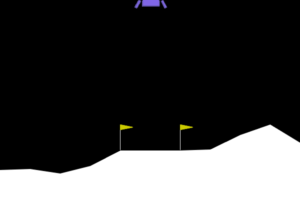
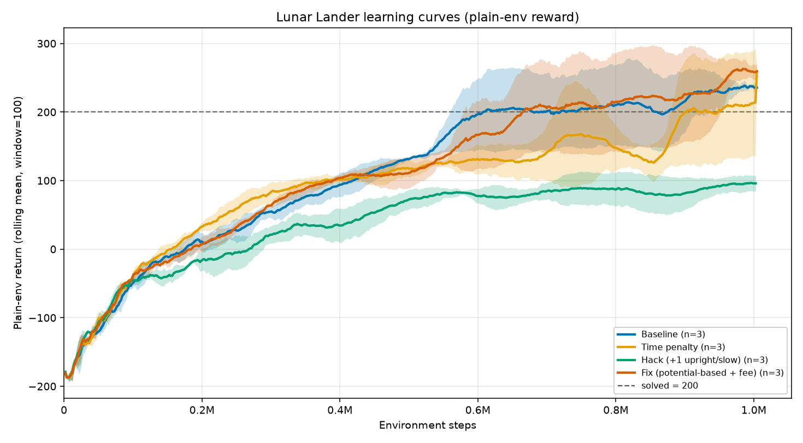

# Lunar Lander: reward hacking, and a fix

PPO on Gymnasium `LunarLander-v3`, trained to land — until a +1-per-frame "upright and slow" bonus teaches it to hover instead. Potential-based shaping (Ng, Harada & Russell 1999) plus a small per-frame fee restores landing.

| Random agent | Baseline landing | Hack: hover | Fix: landing |
| :---: | :---: | :---: | :---: |
|  |  |  |  |

The hover clip is `hack_s0` (timeout rate 93.3% on the independent eval; the lander stays in frame above the pad). `hack_s2` times out on every episode but climbs out of camera; that recording is kept as `assets/hack_s2.gif`. The landing clip is `fix_s1`, the highest plain-env mean among the fix seeds.

## What this is

A small, reproducible study of **reward shaping** on `LunarLander-v3` with Stable-Baselines3 PPO (`MlpPolicy`). Four variants, three training seeds each, about 1M environment steps (1,007,616 after rounding up to a whole rollout):

- **Baseline** (`plain`) — unmodified env reward.
- **Time penalty** — subtract 0.05 per step, to discourage dawdling.
- **Hack** — add +1 on every frame the lander is upright and slow (`|angle| < 0.2` rad, speed `< 0.3`). Hovering keeps collecting the bonus; landing ends the episode and the payments.
- **Fix** — pay for *entering* the upright-slow region, not for sitting in it: \(r' = r + \gamma\Phi(s') - \Phi(s) - 0.05\), with \(\Phi(s) = 1[\text{upright and slow}]\) and \(\gamma = 0.999\) (the same discount PPO uses). This is potential-based shaping, which leaves the optimal policy unchanged (Ng et al., 1999), plus a small fee so waiting still costs something.

All learning curves and reported scores are **plain-env** reward: `Monitor` sits *under* the wrapper, so shaped bonuses never enter the plot or the table.

Hyperparameters and wrapper kwargs for the published runs are recorded in `configs/` (`baseline.yaml`, `time_penalty.yaml`, `hack.yaml`, `fix.yaml`). `src/train.py` does not take a `--config` flag; those YAML files are documentation, not a runtime input.

## Results

Independent evaluation: plain env, deterministic actions, **20 episodes × 3 eval seeds** (`2000`, `2001`, `2002`) on each of the three training seeds (**180 episodes per variant**). Landing = the episode ended with the +100 at-rest bonus. Landing, crash and timeout are mutually exclusive (a rest on step 1000 counts as landed, not a timeout). Std is the sample standard deviation of all episode returns pooled under the variant.

| Variant | Seeds | Episodes | Mean score | Std | Landing (+100) | Crash | Timeout | Mean length | Mean train time |
| --- | --- | ---: | ---: | ---: | ---: | ---: | ---: | ---: | ---: |
| Baseline (`plain`) | 0, 1, 2 | 180 | 258.32 | 21.51 | 99.4% | 0.0% | 0.6% | 340.9 | 177.8 s |
| Time penalty (`time_penalty`) | 0, 1, 2 | 180 | 242.64 | 75.56 | 91.1% | 6.7% | 2.2% | 309.0 | 180.2 s |
| Hack (`hack`) | 0, 1, 2 | 180 | −15.98 | 128.86 | 21.7% | 1.1% | 77.2% | 983.9 | 165.0 s |
| Fix (`fix`) | 0, 1, 2 | 180 | 262.99 | 27.24 | 98.3% | 0.0% | 1.7% | 311.4 | 166.4 s |

Per-seed numbers, eval protocol details, and a comparison with the Trainer's and Reward Hacker's own 30-episode evals (seeds 1000–1029) are in `results/results_table.md` and `results/analysis_eval_all.md`.



Plain-env return (rolling mean, window 100 episodes) with a band across the three training seeds and a dashed line at the Gymnasium "solved" threshold of 200. The hack plateaus well below solved: it has learned to stay in the air. The fix tracks the baseline back above 200. The time-penalty band is wide because **seed 1 had not converged by 1M steps** (mean 182.50, landing 73.3%, crash 20.0%); seeds 0 and 2 landed on every evaluated episode (means 274.02 and 271.40).

## The hack

The shaping rule is exactly the one in the project guide: **+1 per frame** when the lander is upright and slow. Thresholds, from `src/wrappers.py`:

- `|obs[4]| < 0.2` rad (about 11.5°)
- `sqrt(vx² + vy²) < 0.3` (observation-scaled speed)

Those payments continue for as long as the predicate holds, including while the lander is airborne. A successful landing *terminates* the episode and cuts off the bonus stream; a hover can run until the 1000-step time limit and collect on the order of 1000 bonus, minus fuel. Hovering out-earns landing, and PPO can learn exactly that.

On the **plain** env (no bonus at eval time) that policy looks like a hover:

- `hack_s0`: landing 6.7%, timeout 93.3%, mean length 994.8, mean return 43.26
- `hack_s1` is **mixed**: landing 58.3%, timeout 38.3%, crash 3.3%, mean 86.17
- `hack_s2`: landing 0%, timeout 100%, mean length 1000, mean return −177.37

Frame-level diagnostics from `results/hack_*_hover.json` (30 deterministic episodes, seeds 1000–1029, same models) measure the fraction of frames that are upright and slow *and neither leg is touching the ground* (`hover_frame_frac`): **88.9%** (`hack_s0`), **92.0%** (`hack_s1`), **95.6%** (`hack_s2`). The broader "upright and slow" fraction, including grounded frames, is 95.0–95.9%.

## The fix

Potential-based shaping (Ng, Harada & Russell, *Policy invariance under reward transformations*, 1999) plus a per-frame fee, in `PotentialShapingFix`:

```text
r' = r + γ Φ(s') − Φ(s) − fee
Φ(s) = 1[upright and slow],   Φ(terminal) = 0
γ = 0.999,   fee = 0.05
```

`γ` matches PPO's discount in `src/train.py` (`PPO_KWARGS["gamma"] = 0.999`; SB3's own default is 0.99). The fee is the same 0.05/step used by the time-penalty variant (at most −50 over 1000 frames). Because the shaping term is a discounted difference of a potential, the optimal policy of the original reward is unchanged; the agent is only *guided*. Staying in the upright-slow region earns `γ − 1 = −0.001` per frame from the potential, so hovering is no longer a reward source. The fee makes waiting costly as well.

Empirically the fix lands again: 96.7%, 98.3% and 100% at-rest landings on seeds 0, 1 and 2, with means 263.19, 265.66 and 260.12 — in the same band as the baseline (258.32 ± 21.51).

## Setup

Python 3.10+ (the published runs were trained on **Python 3.13.5**). CPU is enough; a GPU does not speed up this small-MLP PPO — environment stepping on the CPU dominates. `src/train.py`, `src/evaluate.py` and `src/record.py` take `--device auto|cpu|cuda` (default `cpu`).

A lighter CPU-only install (recommended here):

```bash
python3 -m venv .venv
source .venv/bin/activate
python -m pip install -U pip
python -m pip install swig==4.5.1
python -m pip install torch==2.15.0 --index-url https://download.pytorch.org/whl/cpu
python -m pip install -r requirements.txt
```

`swig` is pinned because `gymnasium[box2d]` / Box2D may need it to compile the bindings when a prebuilt wheel is not available. On the machine used for this repo, Box2D 2.3.10 installed from a prebuilt manylinux wheel, so swig was not required to compile.

On Linux, a plain `pip install torch==2.15.0` from PyPI already pulls CUDA wheels, which is fine for an NVIDIA GPU (e.g. RTX 4050) but is a much larger download. If you installed the CPU wheel first, add `--extra-index-url https://download.pytorch.org/whl/cpu` when installing `requirements.txt` only if pip tries to replace that wheel.

`scripts/setup.sh` is a convenience wrapper: it creates `.venv`, installs swig, optionally installs CPU torch when `TORCH_CPU=1`, then installs `requirements.txt`.

## How to run

From the repo root, with `.venv` active (the run scripts `source .venv/bin/activate` themselves). Env overrides accepted by every variant script: `SEEDS` (default `"0 1"`), `TIMESTEPS` (default `1000000`), `DEVICE` (default `cpu`), `N_ENVS` (default `8`), `EPISODES` (default `30`, used by `src/evaluate.py` inside the scripts), `RUN_PREFIX` (prepended to run names; useful for smoke tests). `run_time_penalty.sh` also accepts `PENALTY` (default `0.05`). `run_hack.sh` and `run_fix.sh` also accept `WRAPPER_KWARGS` (JSON; default `{}` uses the wrapper defaults).

The published results used `SEEDS="0 1 2"`, `TIMESTEPS=1000000`, `DEVICE=cpu`:

```bash
SEEDS="0 1 2" TIMESTEPS=1000000 DEVICE=cpu scripts/run_baseline.sh
SEEDS="0 1 2" TIMESTEPS=1000000 DEVICE=cpu scripts/run_time_penalty.sh
SEEDS="0 1 2" TIMESTEPS=1000000 DEVICE=cpu scripts/run_hack.sh
SEEDS="0 1 2" TIMESTEPS=1000000 DEVICE=cpu scripts/run_fix.sh
# or, in that same order, skipping any script that is missing:
SEEDS="0 1 2" TIMESTEPS=1000000 DEVICE=cpu scripts/run_all.sh
```

Each variant script trains every seed, evaluates on the plain env, and records a GIF/MP4. `run_hack.sh` also writes `results/<run>_hover.json` and records `assets/hack_hover.gif` from the seed with the highest timeout rate. `run_fix.sh` records `assets/fix_landing.gif` from the seed with the highest mean return.

A short smoke test (writes to a prefixed run name so it does not overwrite published artifacts):

```bash
RUN_PREFIX=smoke_ SEEDS=0 TIMESTEPS=4096 N_ENVS=2 EPISODES=2 DEVICE=cpu scripts/run_baseline.sh
```

Train / evaluate / record a single run by hand:

```bash
.venv/bin/python src/train.py --wrapper plain --seed 0 --timesteps 1000000 --device cpu
.venv/bin/python src/train.py --wrapper time_penalty --wrapper-kwargs '{"penalty": 0.05}' --seed 0 --device cpu
.venv/bin/python src/train.py --wrapper hack --seed 0 --device cpu
.venv/bin/python src/train.py --wrapper fix --seed 0 --device cpu

.venv/bin/python src/evaluate.py --model models/plain_s0.zip --episodes 30 --seed 1000 --device cpu
.venv/bin/python src/record.py --random --name random_crash --episodes 3
.venv/bin/python src/record.py --model models/plain_s0.zip --episodes 2 --device cpu
```

Independent multi-seed evaluation (the table above) and the combined learning-curve plot:

```bash
.venv/bin/python src/analysis/evaluate.py \
    --model plain=models/plain_s*.zip \
    --model time_penalty=models/time_penalty_s*.zip \
    --model hack=models/hack_s*.zip \
    --model fix=models/fix_s*.zip \
    --n-episodes 20 --n-eval-seeds 3 --eval-seed-start 2000 \
    --output-dir results --output-stem analysis_eval_all --device cpu

.venv/bin/python src/analysis/plot_curves.py \
    --label 'Baseline=logs/plain_s[012]/*.monitor.csv' \
    --label 'Time penalty=logs/time_penalty_s[012]/*.monitor.csv' \
    --label 'Hack (+1 upright/slow)=logs/hack_s[012]/*.monitor.csv' \
    --label 'Fix (potential-based + fee)=logs/fix_s[012]/*.monitor.csv' \
    --output assets/learning_curves.png \
    --title 'Lunar Lander learning curves (plain-env reward)' \
    --window 100 --solved-threshold 200
```

`TIMESTEPS`, `SEEDS` and `DEVICE` can be overridden with environment variables for a short local run.

## Training times

Wall-clock time per 1,007,616-step run, averaged over the three seeds, from `results/training_times.csv`:

| Variant | Mean wall-clock | Per-seed times |
| --- | ---: | --- |
| Baseline | 177.8 s (2.96 min) | 178.6, 183.2, 171.7 s |
| Time penalty | 180.2 s (3.00 min) | 185.3, 182.2, 173.2 s |
| Hack | 165.0 s (2.75 min) | 165.8, 163.3, 165.9 s |
| Fix | 166.4 s (2.77 min) | 166.4, 166.1, 166.6 s |

These are **not a speed comparison**. Training happened in three parallel batches on an 8-core CPU box: the four Trainer seed-0/1 runs together, then the six Reward Hacker runs together, then the two Trainer seed-2 runs together. Each batch was sharing those cores.

## Repo layout

```text
configs/                 YAML records of the published hyperparameters
scripts/                 setup.sh, run_baseline.sh, run_time_penalty.sh,
                         run_hack.sh, run_fix.sh, run_all.sh
src/train.py             PPO training (optional reward wrapper)
src/evaluate.py          plain-env eval of one model
src/record.py            GIF (< 5 MB) + MP4
src/wrappers.py          plain, time_penalty, hack, fix
src/hover_stats.py       upright/slow/airborne frame fractions
src/analysis/evaluate.py independent multi-seed eval (this table)
src/analysis/plot_curves.py
assets/                  clips, per-run curves, learning_curves.png
logs/<run>/              Monitor CSVs (plain-env reward) and curve.csv
results/                 train/eval/hover JSON, analysis_eval_all.*, results_table.md
models/                  trained zips (gitignored; retrain or download separately)
```

## Future work

- More training seeds, and a proper hyperparameter sweep
- Tuning the time-penalty magnitude (seed 1 of 0.05/step did not converge)
- Other algorithms, e.g. DQN or SAC on a continuous-control variant
- A landing curriculum; wind / turbulence
- Quantifying the hack across a grid of angle and speed thresholds

## License

MIT © 2026 Shreesh Kallapur. See `LICENSE`.

This project follows Hari's Lunar Lander reward-shaping guide ([@harixganesh](https://github.com/harixganesh)). The environment is [Gymnasium](https://gymnasium.farama.org/)'s `LunarLander-v3`; training uses [Stable-Baselines3](https://stable-baselines3.readthedocs.io/).
